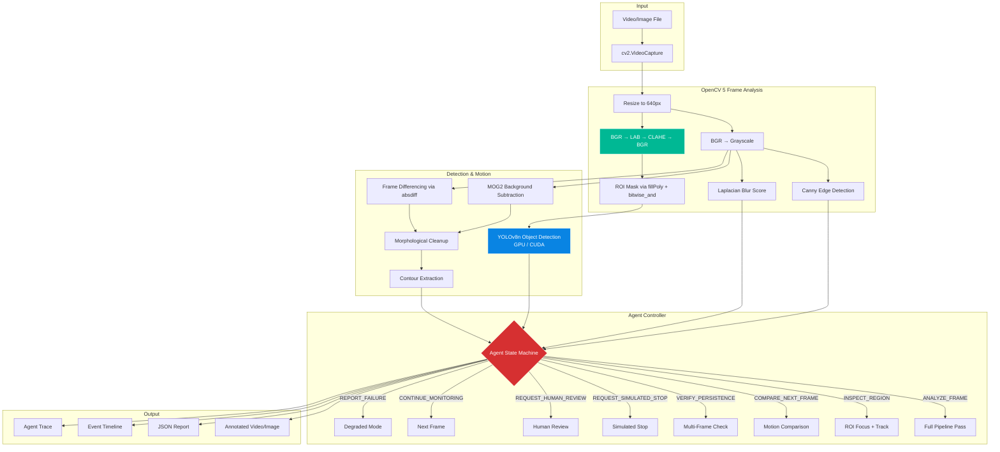
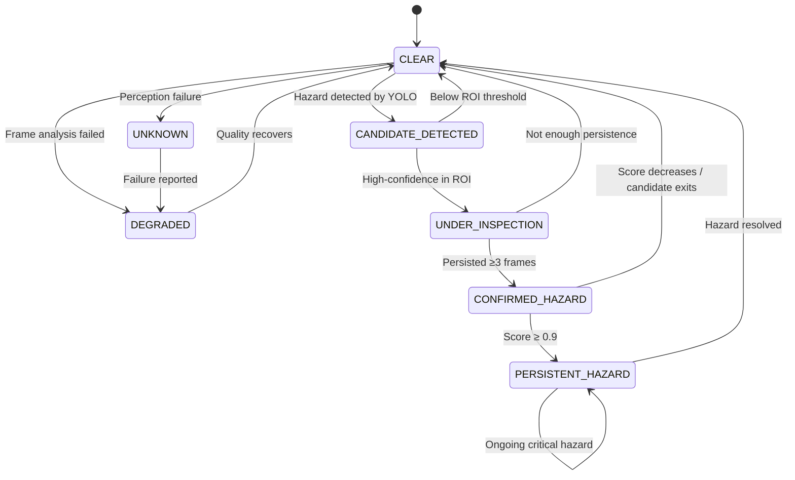
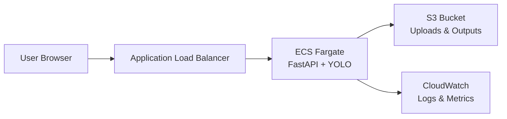

# CampusNav Sentinel — Architecture

## System Overview



## Agent Feedback Loop



## Data Flow Per Frame

```
Frame N
  │
  ├─ FrameAnalyzer
  │   ├─ Resize (640px)
  │   ├─ Grayscale conversion
  │   ├─ CLAHE in LAB color space
  │   ├─ Canny edges → edge_density
  │   ├─ Laplacian → blur_score
  │   ├─ Mean brightness → quality assessment
  │   └─ ROI mask application
  │
  ├─ ObjectDetector (YOLOv8n on GPU)
  │   ├─ Inference on enhanced frame
  │   └─ Filter: hazard classes, confidence ≥ 0.35
  │
  ├─ MotionAnalyzer
  │   ├─ MOG2 foreground mask
  │   ├─ Frame diff with Frame N-1
  │   ├─ Morphological cleanup
  │   └─ Contour → motion_regions
  │
  └─ AgentController (up to 5 iterations)
      │
      ├─ Iteration 1: ANALYZE_FRAME
      │   Evidence: quality, brightness, hazard_count, motion_score
      │   → Decides next action based on evidence
      │
      ├─ Iteration 2: INSPECT_REGION (if hazards found)
      │   Evidence: candidates_in_roi, confidence levels
      │   → Updates tracking state
      │
      ├─ Iteration 3: VERIFY_PERSISTENCE (if high-confidence)
      │   Evidence: seen_count per candidate, frame gaps
      │   → Confirms or drops candidates
      │
      └─ Terminal: CONTINUE_MONITORING / REQUEST_* / REPORT_FAILURE
          → Writes decision to trace
          → Annotates frame with state overlay
          → Emits timeline event if state changed
```

## Module Dependencies

```
app/
├── config.py              ← Environment configuration
├── pipeline.py            ← Orchestrates full video processing
├── cli.py                 ← Command-line entry point
├── perception/
│   ├── frame_analyzer.py  ← OpenCV 5 frame processing (no external deps)
│   ├── motion_analyzer.py ← Background subtraction + frame diff
│   └── detector.py        ← YOLOv8n wrapper (depends on ultralytics, torch)
├── agent/
│   └── controller.py      ← State machine (depends on perception/)
├── api/
│   └── server.py          ← FastAPI web interface (depends on pipeline)
├── templates/
│   └── index.html         ← Dashboard UI
└── static/                ← (reserved for assets)
```

## AWS Architecture (Deployment-Ready)



**Status:** Infrastructure files prepared (Dockerfile, CloudFormation). Not deployed — AWS CLI not available on development machine. The application runs fully locally without AWS.
